# GIF Editor

A high-performance, offline-first mobile multimedia application built with **React Native**, **Expo**, and custom **Kotlin Android native modules**. GIF Editor provides frame-accurate animated GIF editing, multi-frame collaging, and hardware-accelerated bidirectional conversion between GIFs and MP4 videos directly on mobile devices.

[](https://reactnative.dev/)
[](https://docs.expo.dev/)
[](https://www.typescriptlang.org/)
[](https://developer.android.com/)
[](LICENSE)

---

## Table of Contents

1. [Project Overview](#1-project-overview)
2. [Key Features](#2-key-features)
   - [GIF Editing Studio](#gif-editing-studio)
   - [Bidirectional Conversion (Video ↔ GIF)](#bidirectional-conversion-video--gif)
   - [Text Overlay & Typography System](#text-overlay--typography-system)
   - [Cropping & Aspect Ratio Management](#cropping--aspect-ratio-management)
   - [Visual Filters & Fine-Tuning Matrix](#visual-filters--fine-tuning-matrix)
   - [GIF Collage Creator](#gif-collage-creator)
   - [Export & Sharing Pipeline](#export--sharing-pipeline)
   - [Implementation Status](#implementation-status)
3. [Application Screenshots](#3-application-screenshots)
4. [Technology Stack](#4-technology-stack)
   - [Core Frameworks](#core-frameworks)
   - [Custom Native Android Modules](#custom-native-android-modules)
   - [Media Processing Libraries](#media-processing-libraries)
   - [UI, Typography & Gestures](#ui-typography--gestures)
5. [System Requirements](#5-system-requirements)
6. [Installation and Setup](#6-installation-and-setup)
   - [Step-by-Step PowerShell Setup](#step-by-step-powershell-setup)
7. [Building a Release APK](#7-building-a-release-apk)
   - [Local Release Build](#local-release-build)
   - [Installing via ADB](#installing-via-adb)
8. [Project Structure](#8-project-structure)
9. [Application Architecture](#9-application-architecture)
   - [Architectural Data Flow](#architectural-data-flow)
   - [System Architecture Diagram](#system-architecture-diagram)
10. [How to Use the Application](#10-how-to-use-the-application)
    - [Workflow 1: Editing an Existing GIF](#workflow-1-editing-an-existing-gif)
    - [Workflow 2: Converting Video to GIF](#workflow-2-converting-video-to-gif)
    - [Workflow 3: Converting GIF to MP4 Video](#workflow-3-converting-gif-to-mp4-video)
    - [Workflow 4: Creating a Multi-GIF Collage](#workflow-4-creating-a-multi-gif-collage)
11. [Testing and Code Quality](#11-testing-and-code-quality)
    - [Typechecking](#typechecking)
    - [Regression & Geometry Tests](#regression--geometry-tests)
    - [Text Layer Drag Lifecycle Tests](#text-layer-drag-lifecycle-tests)
12. [Limitations and Known Considerations](#12-limitations-and-known-considerations)
13. [Privacy and Permissions](#13-privacy-and-permissions)
14. [Troubleshooting](#14-troubleshooting)
15. [Future Improvements](#15-future-improvements)
16. [Contributing](#16-contributing)
17. [License](#17-license)
18. [Author & Project Information](#18-author--project-information)

---

## 1. Project Overview

### Purpose
**GIF Editor** is an open-source mobile application developed to provide a comprehensive, on-device multimedia editing suite. It eliminates reliance on cloud-based processing servers by executing media decoding, frame extraction, image manipulation, and hardware video encoding locally on the user's Android device.

### The Problem It Solves
Existing mobile GIF utilities frequently suffer from severe limitations:
- **Cloud Dependency & Privacy Risks**: Many popular tools upload private media to remote servers for processing.
- **Watermarking & Quality Degradation**: Exported media is often forced into low resolutions or branded with intrusive watermarks.
- **Distorted Geometry & Aspect Ratios**: Naive cropping and resizing routines frequently distort pixel dimensions, causing stretching or letterboxing.
- **Fragmented Tooling**: Users must alternate between separate apps to trim, adjust playback speed, apply color matrix adjustments, add styled text, and convert formats.

### Target Audience
- **Content Creators & Social Media Managers**: Fast creation of optimized, high-fidelity animated content for social platforms.
- **Meme Creators**: Real-time typography overlays, outlines, shadows, and multi-track timing controls.
- **Mobile Software Engineers**: A reference implementation demonstrating React Native New Architecture (`newArchEnabled=true`), custom Expo Modules in Kotlin, Android `MediaCodec` integration, and Media3/ExoPlayer matrix transformations.

---

## 2. Key Features

### GIF Editing Studio
- **Multi-Segment Timeline**: Real-time playhead scrubber allowing users to seek through individual GIF frames, preview timestamps, split segments, and remove unwanted sections.
- **Hardware-Accelerated Video Preview**: Incorporates `expo-video` (`VideoView`) to deliver smooth playback without UI thread lockup.
- **In-Memory Frame Decoding**: Employs `gifuct-js` and an optimized decoder (`src/services/gif/decoder.ts`) to parse binary GIF streams into composited raw RGBA pixel arrays with delta-patch reconstruction.
- **Playback Speed Controller**: Presets ranging from **0.25x** to **4.0x** (`0.25x`, `0.5x`, `0.75x`, `1.0x`, `1.25x`, `1.5x`, `2.0x`, `4.0x`), modifying both preview rate and output frame delays.

### Bidirectional Conversion (Video ↔ GIF)
- **Video to GIF (`VideoToGifScreen.tsx`)**:
  - Direct frame extraction from device videos (MP4/WebM) via custom native module `VideoFrameExtractor` utilizing Android's `MediaMetadataRetriever`.
  - Configurable FPS sampling, progress tracking, and resolution scaling.
  - Generates optimized GIF files using octree quantization and palette mapping.
- **GIF to Video (`GifToVideoScreen.tsx`)**:
  - Encodes animated GIFs into standard H.264 MP4 videos using custom native module `GifToVideoModule`.
  - Feeds decoded RGBA frame buffers into hardware-accelerated Android `MediaCodec` and multiplexes them with `MediaMuxer`.
  - Provides a built-in synthetic test workflow (accessible via long-press on the home action pill).

### Text Overlay & Typography System
- **Multi-Layer Support**: Add multiple independent text layers on top of the GIF canvas (`TextOverlay.tsx`).
- **20 Google Fonts**: Dynamically loaded via `@expo-google-fonts/*`:
  - *Serif & Display*: Playfair Display, Merriweather, Lora, PT Serif, Abril Fatface.
  - *Sans-Serif & Modern*: Roboto, Lato, Montserrat, Poppins, Nunito, Raleway, Oswald, Fjalla One.
  - *Handwriting & Decorative*: Dancing Script, Pacifico, Amatic SC, Bangers, Righteous, Lobster, Anton.
- **Fine-Grained Text Styling**:
  - Custom font sizes and text alignment (left, center, right).
  - Text fill color selection from an extensive palette.
  - Stroke outlines (configurable width and outline color).
  - Drop shadow and background box opacity controls.
- **Touch-Based Positioning**: Full `PanResponder` touch gestures for drag-and-drop repositioning with boundary clamping within preview bounds.
- **Draft Isolation Lifecycle**: Uncommitted text movements are isolated in draft state until confirmed with **Apply** or discarded with **Cancel**.

### Cropping & Aspect Ratio Management
- **Preset Ratios**:
  - `Free` (unconstrained custom rectangle).
  - `Original` (preserves source asset aspect ratio).
  - `1:1` (Square, optimized for Instagram/avatars).
  - `4:5` (Portrait, optimized for social feeds).
  - `16:9` (Widescreen landscape).
  - `9:16` (Vertical, optimized for Stories and Reels).
- **Interactive Crop Overlay (`CropOverlay.tsx`)**: Four-corner draggable handles with real-time bounding box calculation.
- **Coordinate-Accurate Geometry (`textGeometry.ts`)**: Mathematical coordinate transformation ensuring that cropping parameters and text layer coordinates translate proportionally from preview space to exported pixel buffers without stretching.

### Visual Filters & Fine-Tuning Matrix
- **19 Filter Presets**:
  - *Color & Tone*: Original, Bright, Contrast, Cinematic, Teal & Orange, Noir, Vintage, Cool, Warm, Sepia, Invert, Saturation Boost.
  - *Stylistic*: Fade, Dramatic, Muted, Cyberpunk, Forest, Sunset, Pastel.
- **12 Fine-Tuning Adjustments**:
  - Brightness, Contrast, Saturation, Temperature, Tint, Exposure, Highlights, Shadows, Vibrance, Sharpness, Vignette, and Hue Rotate.
- **Dual-Engine Filtering**:
  - *Preview Stage*: Hardware-accelerated 4x4 RGBA color matrix transformation executed through `modules/video-filter` (`VideoFilterModule.kt` / Android Media3 `RgbMatrix`).
  - *Export Stage*: Software 4x4 matrix color transforms applied across all RGBA frame pixels prior to palette quantization.

### GIF Collage Creator
- **Multi-Item Collage (`GifCollageScreen.tsx`)**: Combine up to 4 GIFs or images into a single animated composite.
- **Grid Layout Templates**:
  - `1x1` (Single asset focus).
  - `1x2` (Two-cell horizontal split).
  - `1x3` (Three-column vertical split).
  - `2x2` (Four-quadrant grid).
- **Independent Cell Controls**: Individual pan and pinch-to-zoom controls for each cell.
- **Frame Synchronization (`collageComposer.ts`, `framePrep.ts`)**: Resamples and synchronizes varying frame counts and frame delays into a coherent unified loop.

### Export & Sharing Pipeline
- **GIF Output (`GifOutputScreen.tsx`)**: Frame-by-frame encoding via `gifenc` with color quantization, metadata inspection (dimensions, duration, file size in MB), and live preview.
- **MP4 Output (`Mp4OutputScreen.tsx`)**: Native H.264 video playback, metadata inspection, and export confirmation.
- **Device Gallery Integration**: Uses `expo-media-library` to save directly to device storage.
- **System Share Sheet**: Uses `expo-sharing` to share output files to messaging apps, email, or cloud storage.

### Implementation Status

| Feature Component | Implementation Status | Implementation Details |
| :--- | :---: | :--- |
| **GIF Timeline & Trimming** | Full | Scrubbing, multi-segment deletion, bounds selection |
| **Draggable Text Layers** | Full | Multi-layer, 20 fonts, outline, shadow, draft isolation |
| **Aspect Ratio Cropping** | Full | 6 presets, corner handles, geometry regression tested |
| **Visual Filters (19 presets + 12 sliders)** | Full | Media3 `RgbMatrix` on preview + pixel transforms on export |
| **Playback Speed Control** | Full | 0.25x – 4.0x rate scaling and frame delay adjustment |
| **GIF Collage (1x1, 1x2, 1x3, 2x2)** | Full | Multi-GIF synchronization, pan/zoom per cell |
| **GIF to MP4 Video** | Full (Android) | Native Kotlin `MediaCodec` H.264 + `MediaMuxer` |
| **Video to GIF** | Full (Android) | Native Kotlin `MediaMetadataRetriever` + `gifenc` |
| **Save to Gallery & Share** | Full | `expo-media-library` & `expo-sharing` |
| **iOS Native Module Parity** | Partial / Unsupported | Kotlin native modules target Android. iOS contains stub module |

---

## 3. Application Screenshots

> *Note: Placeholders below indicate verified screens implemented in `src/screens/`. Authentic screen captures will be populated upon production device deployment.*

| Home & Quick Actions | GIF Editing Studio | Text Overlay & Fonts |
| :---: | :---: | :---: |
|  |  |  |
| *Import GIF, Quick Action Pills* | *Timeline Scrubber & Real-Time Preview* | *Draggable Text & Google Fonts* |

| Filter & Color Studio | Video ↔ GIF Conversion | Multi-GIF Collage |
| :---: | :---: | :---: |
|  |  |  |
| *Presets & 12 Adjustment Sliders* | *Native Frame Extraction & H.264* | *Multi-Cell Grid Layouts (2x2)* |

---

## 4. Technology Stack

### Core Frameworks
- **React Native (`0.86.3`)**: Core mobile application architecture with New Architecture enabled (`newArchEnabled=true`) and Hermes JavaScript Engine (`hermesEnabled=true`).
- **Expo SDK (`~57.0.25`)**: Managed native module ecosystem providing lifecycle bindings, dev client support, and peripheral access.
- **TypeScript (`~6.0.3`)**: Comprehensive type safety across components, utilities, geometry calculations, and services.
- **React (`19.2.3`)**: Component lifecycle, memoized render states, and state hooks.

### Custom Native Android Modules
Located in the `modules/` directory, these custom modules interface directly with Android native APIs:
- **`modules/gif-to-video` (`GifToVideoModule.kt`)**:
  - Utilizes Android `MediaCodec` (configured for `video/avc` / H.264) and `MediaMuxer`.
  - Ingests raw RGBA frame byte buffers from React Native, encodes video frames with hardware acceleration, and outputs standard MP4 files.
- **`modules/video-filter` (`VideoFilterModule.kt`)**:
  - Implements real-time 4x4 RGBA color matrix transforms.
  - Leverages Android Media3 / ExoPlayer `RgbMatrix` integration to preview visual filters without CPU lag.
- **`modules/video-frame-extractor` (`VideoFrameExtractorModule.kt`)**:
  - Employs Android `MediaMetadataRetriever` to extract video frames at defined timestamps into PNG files and raw byte arrays for GIF conversion.

### Media Processing Libraries
- **`gifuct-js` (`^2.1.2`)**: Client-side GIF parsing library used to unpack GIF binary data into headers, logical screens, graphics control extensions, and frame pixel patches.
- **`gifenc` (`^1.0.3`)**: Fast, lightweight JavaScript GIF encoder providing NeuQuant / octree palette quantization (`quantize`), color index assignment (`applyPalette`), and frame buffer encoding.
- **`expo-video` (`~57.0.5`)**: High-performance video player supporting native hardware playback during timeline scrubbing and video previews.
- **`expo-image-picker` (`~57.0.20`)**: System media picker for importing local GIFs, videos, and images.
- **`expo-media-library` (`~57.0.5`)**: Direct access to the Android MediaStore to save exported assets to the user's gallery.
- **`expo-sharing` (`~57.0.22`)**: Native Android Intent share sheet integration.

### UI, Typography & Gestures
- **`lucide-react-native` (`^1.47.0`)**: Comprehensive vector iconography.
- **`@expo-google-fonts/*`**: 20 Google font families bundled for offline rendering.
- **`react-native-safe-area-context` (`~5.7.0`)**: Edge-to-edge layout management handling notches, navigation bars, and status bars.
- **`react-native-svg` (`15.15.4`)**: Vector graphics and crop guide rendering.
- **`expo-linear-gradient` (`~57.0.2`)**: Vibrant UI gradients for buttons, headers, and cards.

---

## 5. System Requirements

### Host Development Machine
- **Operating System**: Windows 10/11 (64-bit), macOS, or Linux.
- **Node.js**: `v18.x` or `v20.x` LTS.
- **Package Manager**: `npm` (v9+ or v10+) or `npx`.
- **Java Development Kit**: **JDK 17** (verified with Eclipse Adoptium Temurin `jdk-17.0.18.8-hotspot`).
- **Android SDK**:
  - Android SDK Platform `34` or `35` (defined via Expo SDK 57 build scripts).
  - Android SDK Build-Tools `34.0.0` or `35.0.0`.
  - Android NDK (installed via Android Studio SDK Tools).
- **Environment Variables**:
  - `ANDROID_HOME` pointing to your Android SDK root (e.g., `C:\Users\<Username>\AppData\Local\Android\Sdk`).
  - `JAVA_HOME` pointing to JDK 17 (e.g., `C:\Program Files\Eclipse Adoptium\jdk-17.0.18.8-hotspot`).
  - System `PATH` containing `%ANDROID_HOME%\platform-tools` and `%JAVA_HOME%\bin`.

### Target Android Device / Emulator
- **Minimum OS Version**: Android 8.0 (API Level 26) or higher.
- **Recommended OS Version**: Android 12, 13, 14, or 15 (API Levels 31–35).
- **Architecture**: `arm64-v8a`, `armeabi-v7a`, `x86`, or `x86_64`.
- **Debugging**: USB Debugging enabled in Developer Options.

> [!IMPORTANT]
> Because this application incorporates custom native Kotlin modules (`modules/gif-to-video`, `modules/video-filter`, `modules/video-frame-extractor`), **standard Expo Go from the Google Play Store cannot run this app**. It must be run using a development build (`npx expo run:android`) or installed as an APK.

---

## 6. Installation and Setup

Follow these step-by-step instructions using **Windows PowerShell**:

### Step-by-Step PowerShell Setup

#### 1. Clone the Repository
```powershell
git clone https://github.com/npehesara/GifEditor.git
Set-Location GifEditor
```

#### 2. Install Node Dependencies
Install all required packages matching the project lockfile:
```powershell
npm install
```

#### 3. Verify TypeScript Typechecking
Verify that all source code, screen definitions, and type signatures compile with zero errors:
```powershell
npx tsc --noEmit
```

#### 4. Run Verification Test Scripts
Execute the regression test suites to verify math geometry and drag lifecycle behavior:
```powershell
node scripts/test-drag-lifecycle.js
node scripts/test-regression.js
```

#### 5. Verify Android Environment & Connected Device
Verify that your Android SDK and ADB detect your connected physical device or emulator:
```powershell
adb devices
```
*Ensure your device displays `device` (not `unauthorized` or `offline`).*

#### 6. Build and Run the Android Application
Compile the native Android code and launch the development build:
```powershell
npx expo run:android
```
*This command invokes Gradle to compile the custom Kotlin native modules and React Native host app, installs the APK on your device, and starts the Metro development server.*

#### 7. Starting the Metro Bundler Separately (Optional)
If the native app is already installed on your device:
```powershell
npx expo start
```

---

## 7. Building a Release APK

### Local Release Build
To generate a standalone release APK for testing or direct distribution on an Android device:

```powershell
# Navigate into the android directory
Set-Location android

# Assemble the release APK using the Gradle wrapper
./gradlew assembleRelease

# Return to root directory
Set-Location ..
```

### Expected Output Path
Upon successful compilation, the signed release APK is generated at:
```
android/app/build/outputs/apk/release/app-release.apk
```

### Installing via ADB
With your Android device connected via USB:
```powershell
adb install -r android/app/build/outputs/apk/release/app-release.apk
```

> [!NOTE]
> As configured in `android/app/build.gradle` (lines 108–115), local release builds sign the package using the included `debug.keystore`. For official Google Play Store distribution, configure a custom production release keystore in `android/app/build.gradle` or utilize Expo Application Services (`eas build`).

---

## 8. Project Structure

```
GifEditor/
├── android/                         # Android native project and Gradle configuration
│   ├── app/                         # Android application module (build.gradle, AndroidManifest.xml)
│   ├── gradle/wrapper/              # Gradle wrapper (v9.3.1)
│   ├── build.gradle                 # Root project build script
│   └── gradle.properties            # New Architecture, Hermes, and JVM memory flags
├── assets/                          # Application icons, splash screens, and adaptive drawables
├── modules/                         # Custom local Expo native modules
│   ├── gif-to-video/                # Kotlin module: H.264 MP4 encoding via MediaCodec
│   │   ├── android/src/main/java/expo/modules/giftovideo/GifToVideoModule.kt
│   │   ├── expo-module.config.json
│   │   └── index.ts
│   ├── video-filter/                # Kotlin module: 4x4 RGBA color matrix transforms (Media3)
│   │   ├── android/src/main/java/expo/modules/videofilter/VideoFilterModule.kt
│   │   └── expo-module.config.json
│   └── video-frame-extractor/       # Kotlin module: Frame extraction via MediaMetadataRetriever
│       ├── android/src/main/java/expo/modules/videoframeextractor/VideoFrameExtractorModule.kt
│       ├── expo-module.config.json
│       └── ios/                     # iOS stub module definition
├── scripts/                         # Verification and regression test scripts
│   ├── test-drag-lifecycle.js       # Mathematical simulation of PanResponder drag boundaries
│   └── test-regression.js           # Math tests for aspect ratio preservation & export geometry
├── src/                             # TypeScript application source code
│   ├── components/
│   │   ├── common/
│   │   │   └── Header.tsx           # Standard application top header
│   │   └── editor/
│   │       ├── CropControls.tsx     # Aspect ratio selection buttons
│   │       ├── CropOverlay.tsx      # Draggable crop rectangle and corner handles
│   │       ├── FilterControls.tsx   # Filter preset list and fine-tuning sliders
│   │       ├── SpeedControls.tsx    # Playback speed buttons (0.25x - 4x)
│   │       ├── TextControls.tsx     # Font family, color, outline, and size controls
│   │       ├── TextOverlay.tsx      # Draggable multi-layer canvas text overlays
│   │       └── TextTimelineTrack.tsx# Text track scrubber controls
│   ├── constants/
│   │   ├── colors.ts                # Application theme palette
│   │   ├── filters.ts               # 19 preset matrix definitions and 12 slider bounds
│   │   ├── fonts.ts                 # Font registry for 20 Google Fonts
│   │   └── stickers.ts              # Decorative sticker definitions
│   ├── screens/
│   │   ├── HomeScreen.tsx           # Entry screen with import buttons and quick actions
│   │   ├── GifEditorScreen.tsx      # Core studio: timeline, trim, crop, filter, text, speed
│   │   ├── GifCollageScreen.tsx     # Multi-item GIF collage builder (1x1, 1x2, 1x3, 2x2)
│   │   ├── GifToVideoScreen.tsx     # GIF-to-MP4 conversion screen
│   │   ├── VideoToGifScreen.tsx     # Video-to-GIF extraction and encoding screen
│   │   ├── PreviewScreen.tsx        # Pre-export full-screen video/GIF player
│   │   ├── GifOutputScreen.tsx      # Exported GIF preview, metadata, save, and share
│   │   └── Mp4OutputScreen.tsx      # Exported MP4 preview, metadata, save, and share
│   ├── services/
│   │   ├── collage/
│   │   │   ├── collageComposer.ts   # Multi-cell frame compositing and layout math
│   │   │   └── framePrep.ts         # Frame rate alignment and canvas resizing
│   │   ├── gif/
│   │   │   ├── decoder.ts           # Binary GIF parsing and frame patch reconstitution
│   │   │   └── sampleGifs.ts        # Built-in sample assets for testing
│   │   └── storage/
│   │       ├── fileCache.ts         # Temporary file cleanup and cache management
│   │       └── projectStore.ts      # Project serialization and persistence
│   ├── types/
│   │   ├── editor.ts                # Interfaces for layers, crops, filters, and frames
│   │   └── project.ts               # Project metadata models
│   └── utils/
│       ├── filterMatrix.ts          # 4x4 color matrix math calculations
│       ├── formatters.ts            # Bytes-to-MB and millisecond-to-time formatters
│       └── textGeometry.ts          # Preview-to-export bounding box math transforms
├── App.tsx                          # Root coordinator, font initialization, and screen router
├── app.json                         # Expo configuration, plugins, and Android permissions
├── package.json                     # Dependency manifests and scripts
└── tsconfig.json                    # TypeScript compiler configuration
```

---

## 9. Application Architecture

### Architectural Data Flow
1. **Media Ingestion**:
   - Assets are imported via `expo-image-picker` or loaded from cache.
   - GIFs are parsed by `decoder.ts` using `gifuct-js`, transforming raw GIF bytes into RGBA frame buffers.
   - Videos are sampled by `VideoFrameExtractorModule` via native `MediaMetadataRetriever`.
2. **Editor Canvas & State Management**:
   - `GifEditorScreen.tsx` orchestrates editing state (playback position, active tool, crop boundaries, active filters, text layer collection).
   - Video playback preview is powered by `expo-video` (`VideoView`).
   - Interactive overlays (`TextOverlay`, `CropOverlay`) run on React Native `PanResponder` systems, maintaining independent draft states to ensure smooth gesture tracking.
3. **Export Processing Pipelines**:
   - **GIF Pipeline**:
     - `textGeometry.ts` calculates precise coordinate scaling between preview viewports and export bitmaps.
     - Frame patches are composited, cropped, and passed through the 4x4 color transformation matrix (`filterMatrix.ts`).
     - Rendered text layers are rasterized onto the frame pixels.
     - `gifenc` performs color quantization (`quantize`) and palette mapping (`applyPalette`), outputting encoded binary GIF files.
   - **MP4 Pipeline**:
     - Decoded RGBA frame buffers are passed to `GifToVideoModule.kt`.
     - Android `MediaCodec` encodes frames into an H.264 elementary stream, which is packaged into an MP4 container by `MediaMuxer`.
4. **Output & Persistence**:
   - Results are written to the application cache directory (`expo-file-system`).
   - `expo-media-library` saves media into the public device gallery.
   - `expo-sharing` triggers the Android system share sheet.

### System Architecture Diagram

```mermaid
graph TD
    subgraph UI_Layer ["UI & Interaction Layer (React Native / TypeScript)"]
        App["App.tsx (Root Controller & Router)"]
        Home["HomeScreen.tsx"]
        Editor["GifEditorScreen.tsx"]
        Collage["GifCollageScreen.tsx"]
        V2G["VideoToGifScreen.tsx"]
        G2V["GifToVideoScreen.tsx"]
        OutputGIF["GifOutputScreen.tsx"]
        OutputMP4["Mp4OutputScreen.tsx"]
        
        subgraph EditorComponents ["Editor Sub-Components"]
            Crop["CropOverlay.tsx"]
            Text["TextOverlay.tsx (PanResponder)"]
            Filters["FilterControls.tsx"]
            Timeline["TextTimelineTrack.tsx"]
        end
    end

    subgraph Logic_Layer ["Math & Processing Utilities"]
        Geometry["textGeometry.ts (Aspect & Bounds Math)"]
        Matrix["filterMatrix.ts (4x4 Color Math)"]
        Decoder["decoder.ts (gifuct-js Frame Unpacking)"]
        Encoder["gifenc (Quantization & Palette Encoding)"]
        CollageComp["collageComposer.ts (Frame Sync)"]
    end

    subgraph Native_Layer ["Custom Native Android Modules (Kotlin)"]
        VFilterModule["VideoFilterModule.kt (Android Media3 / ExoPlayer RgbMatrix)"]
        VExtractModule["VideoFrameExtractorModule.kt (MediaMetadataRetriever)"]
        G2VModule["GifToVideoModule.kt (MediaCodec H.264 + MediaMuxer)"]
    end

    subgraph OS_Layer ["Android OS & Device APIs"]
        ExoPlayer["Android Media3 / ExoPlayer Engine"]
        MediaCodec["Android Hardware Video Encoder"]
        Retriever["Android MediaMetadataRetriever"]
        MediaStore["Android MediaStore & FileSystem"]
    end

    %% UI Connections
    App --> Home
    App --> Editor
    App --> Collage
    App --> V2G
    App --> G2V
    App --> OutputGIF
    App --> OutputMP4

    Editor --> Crop
    Editor --> Text
    Editor --> Filters
    Editor --> Timeline

    %% Logic Connections
    Editor --> Geometry
    Editor --> Matrix
    Editor --> Decoder
    Editor --> Encoder
    Collage --> CollageComp

    %% Native Module Connections
    Filters --> VFilterModule
    VFilterModule --> ExoPlayer
    V2G --> VExtractModule
    VExtractModule --> Retriever
    G2V --> G2VModule
    G2VModule --> MediaCodec

    %% Storage Connections
    OutputGIF --> MediaStore
    OutputMP4 --> MediaStore
```



---

## 10. How to Use the Application

### Workflow 1: Editing an Existing GIF
1. **Importing Media**: From the Home Screen, tap **Import a GIF** to select a `.gif` file from your device gallery.
2. **Timeline Navigation**: Use the scrubber at the bottom to navigate frame-by-frame or scrub across segments.
3. **Trimming**: Tap the **Trim** tool to adjust start and end boundary handles.
4. **Cropping**: Tap **Crop** to choose an aspect ratio (`Free`, `1:1`, `4:5`, `16:9`, `9:16`, or `Original`). Adjust the corner handles on the canvas and tap **Apply**.
5. **Adjusting Speed**: Tap **Speed** and select a multiplier from `0.25x` to `4.0x`.
6. **Applying Filters**:
   - Tap **Filters** and choose from 19 visual presets (e.g., *Teal & Orange*, *Noir*, *Cinematic*).
   - Tap **Adjust** to fine-tune individual sliders (Brightness, Contrast, Saturation, Vignette, etc.).
7. **Adding Styled Text**:
   - Tap **Text** and enter your desired caption.
   - Choose from 20 Google Fonts, select colors, add an outline or shadow, and adjust font size.
   - Drag the text across the preview canvas to position it.
   - Tap **Apply** to confirm layer placement.
8. **Exporting**: Tap **Export** in the top header. The progress modal will display frame-rendering progress, opening **GifOutputScreen** upon completion. Tap **Save to Gallery** or **Share**.

### Workflow 2: Converting Video to GIF
1. On the Home Screen, tap the **Video → GIF** quick action pill.
2. Select an MP4 or compatible video from your device (maximum supported duration: 60 seconds).
3. The app will extract frames using the native frame extractor and quantify colors into a GIF.
4. Preview the resulting GIF and save it directly to your gallery.

### Workflow 3: Converting GIF to MP4 Video
1. On the Home Screen, tap the **GIF → Video** quick action pill.
2. Select an animated GIF.
3. The app feeds the decoded frames into Android's native `MediaCodec` H.264 hardware encoder.
4. The generated MP4 video is displayed on **Mp4OutputScreen**, ready for sharing or saving.

### Workflow 4: Creating a Multi-GIF Collage
1. On the Home Screen, tap the **GIF Collage** quick action pill.
2. Select a grid layout template (`1x1`, `1x2`, `1x3`, or `2x2`).
3. Tap each grid cell to import a GIF or photo.
4. Pan and pinch-to-zoom within individual cells to frame each asset.
5. Tap **Export Collage** to synthesize the synchronized frames into a single unified GIF.

---

## 11. Testing and Code Quality

### Typechecking
The project uses TypeScript in strict mode. Run type validation without emitting files:

```powershell
npx tsc --noEmit
```
*Expected output: Exits with code 0 (zero errors).*

---

### Regression & Geometry Tests
Mathematical calculations for crop dimensions, preview viewport scaling, text coordinates, and layer isolation are verified through `scripts/test-regression.js`.

Execute the test suite:
```powershell
node scripts/test-regression.js
```

**Observed Test Results**:
```text
Running GIF Export & Text Layer Regression Tests...
✔ Test 1: Portrait GIF without cropping preserved aspect ratio (240x480 for 300x600)
✔ Test 2: Landscape GIF without cropping preserved aspect ratio (480x240 for 800x400)
✔ Test 3: Square GIF without cropping remains square (480x480)
✔ Test 4: Explicit crop exports only the cropped rectangle (240x240 at cx=120, cy=0)
✔ Test 5: Text coordinate transform and font scaling exact
✔ Test 6: Draft isolation, cancel, apply, and multi-layer independence confirmed

All 6 regression test suites passed successfully!
```

---

### Text Layer Drag Lifecycle Tests
The drag-and-drop gesture lifecycle, boundary clamping, and draft persistence are verified through `scripts/test-drag-lifecycle.js`.

Execute the test suite:
```powershell
node scripts/test-drag-lifecycle.js
```

**Observed Test Results**:
```text
Testing Text Layer Free Movement Drag Lifecycle...
✔ Step 1-4: Dragged to top-left area and released. Text stays at exact position (40, 40).
✔ Step 5-6: Dragged back to center and released. Text stays at exact center (180, 180).
✔ Step 7-8: Dragged near bottom-right corner and released. Text stays at exact position (330, 330).
✔ Step 9-10: Pressed Apply. Position remained unchanged at (330, 330). Editing mode exited.
✔ Step 11: Switched tools and back. Committed position strictly preserved.
✔ Step 12: Reopened Text tool. Saved position preserved identically without jump.

All drag lifecycle tests passed successfully!
```

---

## 12. Limitations and Known Considerations

1. **Android-Exclusive Native Processing**:
   - Custom native modules (`modules/gif-to-video`, `modules/video-filter`, and `modules/video-frame-extractor`) are implemented in Kotlin for Android (`android/`).
   - The iOS directory contains only an empty module stub (`VideoFrameExtractorModule.swift`). Compiling for iOS will not provide hardware video encoding, native frame extraction, or real-time ExoPlayer matrix filtering.
2. **Expo Go Incompatibility**:
   - Because of the custom Kotlin modules, the application cannot run inside the pre-built Expo Go app. Developers must run `npx expo run:android` or create a development build via `expo-dev-client`.
3. **Video-to-GIF Duration Constraint**:
   - `VideoToGifScreen.tsx` enforces a maximum video duration of 60 seconds to prevent mobile memory exhaustion during frame extraction.
4. **Memory Usage with Large High-FPS GIFs**:
   - Color quantization and frame extraction occur in the JavaScript runtime (Hermes). Processing high-resolution GIFs (>1080p) with large frame counts (>300 frames) on entry-level Android hardware may experience prolonged export times.

---

## 13. Privacy and Permissions

### Requested Android Permissions
Configured in `app.json`:
- **`READ_MEDIA_IMAGES` & `READ_MEDIA_VIDEO`**: Required on Android 13+ (API 33+) to allow users to select GIFs and videos from their photo gallery.
- **`READ_EXTERNAL_STORAGE` & `WRITE_EXTERNAL_STORAGE`**: Required on Android 12 and below to read media and save exported GIFs/videos to external storage.

### Data Privacy & Offline Execution
- **100% Offline Processing**: All frame decoding, cropping, matrix adjustments, text rasterization, and video encoding occur strictly on the user's local device.
- **No Cloud Services**: The application contains no remote API backends, no tracking analytics, and no external telemetry.
- **Media Isolation**: Media selected by the user is read from local storage, processed in application cache directories, and saved only when explicitly requested by the user.

---

## 14. Troubleshooting

### 1. `adb devices` Does Not Detect Android Device
- Verify that your physical device has **USB Debugging** enabled under Developer Options.
- In PowerShell, restart the ADB server:
  ```powershell
  adb kill-server
  adb start-server
  adb devices
  ```
- Reconnect the USB cable and approve the **Allow USB Debugging** prompt on your phone screen.

### 2. JDK Version Incompatibilities
- React Native 0.86 and Gradle 9.3 require **JDK 17**. If you receive errors such as `Unsupported class file major version`, check your active Java version:
  ```powershell
  java -version
  ```
- Ensure `JAVA_HOME` points to JDK 17:
  ```powershell
  $env:JAVA_HOME = "C:\Program Files\Eclipse Adoptium\jdk-17.0.18.8-hotspot"
  ```

### 3. Gradle Out of Memory (OOM) Errors
- The project configures Gradle memory settings in `android/gradle.properties`:
  ```properties
  org.gradle.jvmargs=-Xmx2048m -XX:MaxMetaspaceSize=512m
  ```
- If your build fails with `Java heap space`, ensure your development machine has at least 4 GB of free RAM available before compiling.

### 4. Custom Native Module Linking Issues
- If you receive an error indicating `Cannot find native module 'GifToVideo'` or `VideoFrameExtractor`:
  - Ensure you did **not** run the project using standard Expo Go.
  - Re-run the local build command to regenerate native bindings:
    ```powershell
    npx expo run:android
    ```

### 5. Cleaning Android Build Cache
If you encounter persistent build or packaging errors in Gradle:
```powershell
Set-Location android
./gradlew clean
Set-Location ..
npx expo run:android
```

---

## 15. Future Improvements

The following items represent potential future developments based on the current architecture:
- **iOS Native Module Parity**: Implement Swift equivalents using AVFoundation (`AVAssetReader`, `AVAssetWriter`) for `GifToVideoModule` and `VideoFrameExtractorModule`.
- **Undo / Redo Edit Stack**: Implement a history state stack allowing users to step backward and forward through edits.
- **Pinch-to-Resize & Rotate Gestures**: Add multi-touch scaling and rotation directly to individual text and sticker overlays.
- **Timeline Zoom**: Provide timeline zoom capabilities to allow fine-grained sub-frame selection on long GIFs.
- **Animated Text Overlays**: Support keyframed text movement and fade-in/fade-out animations.

---

## 16. Contributing

Contributions are welcome! Please follow these steps:

1. **Fork the Repository**:
   Click **Fork** on the GitHub repository page: `https://github.com/npehesara/GifEditor`.
2. **Create a Feature Branch**:
   ```powershell
   git checkout -b feature/your-feature-name
   ```
3. **Make Your Changes**:
   Ensure you maintain clean TypeScript types and preserve existing architecture patterns.
4. **Run Validation Checks**:
   ```powershell
   npx tsc --noEmit
   node scripts/test-drag-lifecycle.js
   node scripts/test-regression.js
   ```
5. **Commit Your Changes**:
   ```powershell
   git commit -m "Add: descriptive summary of your changes"
   ```
6. **Push to Your Fork**:
   ```powershell
   git push origin feature/your-feature-name
   ```
7. **Open a Pull Request**:
   Submit a Pull Request targeting the `main` branch with a clear description of your modifications.

---

## 17. License

This project is licensed under the **MIT License**.

See the full license text in the [LICENSE](LICENSE) file.

---

## 18. Author & Project Information

- **Author**: Navod Pehesara ([@npehesara](https://github.com/npehesara))
- **Email**: `swnavodpehesara@gmail.com`
- **Repository**: [https://github.com/npehesara/GifEditor](https://github.com/npehesara/GifEditor)
- **Application Package**: `com.gifeditor.app`
- **Version**: `1.0.0`
